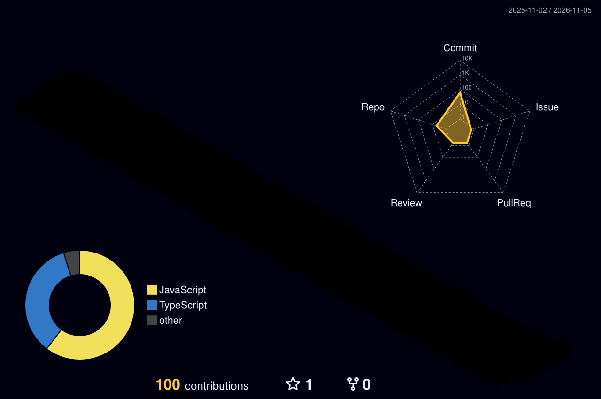

<h1 align="center">Hey  I'm Jhunkcion</h1>

## 📌 About Me
- 💡 Fullstack Developer & Game Development enthusiast.
- 🚀 Passionate about building clean web architectures, scalable backend services, and interactive systems.
- 🛠️ Currently developing and maintaining modern fullstack projects with **TypeScript**, **React**, and **PHP**.
- 🎮 Exploring interactive web simulations, mechanics design, and creative coding.
- 🤝 Open to collaboration on impactful web projects and open-source software.

## 🚀 Featured Projects

<table>
  <tr>
    <td width="50%" valign="top">
      
      <h3 align="center">💎 Crevia</h3>
      
Modern scalable web platform featuring reactive frontend components and structured backend architecture.

      

        <a href="https://github.com/Jhunkcion/Crevia"><b>🔗 View Repository</b></a>
      

    </td>
    <td width="50%" valign="top">
      
      <h3 align="center">📋 BBPSDMP Komdigi API Docs</h3>
      
Official technical documentation and interactive API reference portal developed for BBPSDMP Komdigi Medan.

      

        <a href="https://github.com/Jhunkcion/BBPSDMP-Komdigi-s-API-Docs"><b>🔗 View Repository</b></a>
      

    </td>
  </tr>
  <tr>
    <td width="50%" valign="top">
      
      <h3 align="center">👥 SiAMang</h3>
      
Sistem Informasi Anak Magang — Web-based management platform for tracking apprentice and internship workflows.

      

        <a href="https://github.com/Jhunkcion/SiAMang"><b>🔗 View Repository</b></a>
      

    </td>
    <td width="50%" valign="top">
      
      <h3 align="center">🎮 idle-game</h3>
      
Interactive web-based simulation exploring incremental progression, idle game mechanics, and state management.

      

        <a href="https://github.com/Jhunkcion/idle-game"><b>🔗 View Repository</b></a>
      

    </td>
  </tr>
</table>

## 📊 GitHub Stats & Streak

  
  

  

## 🛠️ Languages & Tools

> ## Programming Languages

  
  
  
  
  
  

> ## Frontend

  
  
  
  
  
  

> ## Backend

  
  

> ## Database

  
  
  
  
  

> ## DevOps & Cloud

  
  
  
  
  
  

> ## Tools

  
  
  
  
  
  

## 🔗 Connect with Me

  
  

<picture>
  <source media="(prefers-color-scheme: dark)" srcset="./profile-3d-contrib/profile-night-rainbow.svg">
  <source media="(prefers-color-scheme: light)" srcset="./profile-3d-contrib/profile-season.svg">
  
</picture>

### Jhunkcion — what these towers mean

- **Tall** weeks = pairing on greenfield work
- **Flat** stretches = vacations or deep-research weeks
- **Spiky** weekends = side projects, [Portfolio](https://nekomarukiyo.github.io)
